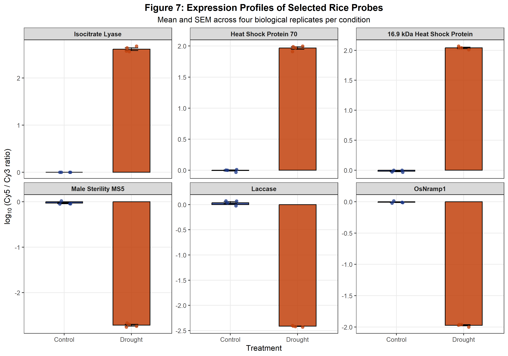

```{r setup, include=FALSE}
knitr::opts_chunk$set(
  echo = FALSE,
  warning = FALSE,
  message = FALSE,
  fig.align = "center",
  out.width = "90%"
)

library(knitr)

# This R Markdown file is stored in the report/ folder.
# The paths below are relative to that folder.
qc_stats <- read.csv("../results/sample_qc_summary.csv")
pca_variance <- read.csv("../results/pca_variance_explained.csv")
sig_probes <- read.csv("../results/significant_probes_annotated.csv")
up_probes <- read.csv("../results/upregulated_probes_annotated.csv")
down_probes <- read.csv("../results/downregulated_probes_annotated.csv")
functional_categories <- read.csv("../results/functional_category_summary.csv")
annotation_coverage <- read.csv("../results/annotation_coverage_summary.csv")

# Select a small, readable set of known top probes for the results table.
selected_probe_ids <- c("39577", "44040", "14199", "41300", "44259", "35235")
top_probe_table <- sig_probes[
  as.character(sig_probes$ProbeID) %in% selected_probe_ids,
  intersect(c("ProbeID", "logFC", "adj.P.Val", "Description"), names(sig_probes)),
  drop = FALSE
]
```

# Abstract {.unnumbered}

Drought stress is an important environmental constraint on rice (*Oryza sativa*) production. Understanding the molecular responses of rice to water limitation can help identify candidate genes and processes associated with stress responses. This study analysed a publicly available rice microarray dataset, GSE115826, to identify probes showing differential expression between drought-stressed and control seedling shoots.

The dataset was generated using the Agilent-015241 Rice Gene Expression 4 × 44K microarray platform (GPL6864) and contained eight samples: four control samples and four drought-stressed samples. The deposited expression measurements were normalized log10 Cy5/Cy3 ratios from a two-colour reference design. After filtering non-biological control spots, 43,734 biological probes were retained. Quality control, exploratory data analysis, principal component analysis, and differential expression analysis were performed. The Limma package was used to fit a linear model and estimate the drought-versus-control contrast. Differentially expressed probes were selected using an adjusted p-value below 0.05 and an absolute log10 fold change of at least log10(2), equivalent to a two-fold change.

The analysis identified 21,208 significant probes, comprising 11,447 upregulated probes and 9,761 downregulated probes. Annotation linked 20,945 significant probes to RAP-DB identifiers, representing 15,133 unique RAP-DB loci. Preliminary keyword-based functional classification grouped some annotated probe descriptions into categories including signal transduction, metabolism, membrane transport, transcriptional regulation, redox-related functions, and chaperone responses.

These findings describe probe-level expression differences associated with drought treatment in this dataset. The results should be interpreted with the limitations of the sample size, microarray platform, probe-to-locus mapping, and preliminary keyword-based functional classification in mind. Further validation is required before individual candidates or biological mechanisms can be considered confirmed.

# 1. Introduction

Rice (*Oryza sativa*) is a major staple crop and an important source of dietary energy for people worldwide. Rice production is affected by environmental stresses, including drought. Water deficit can influence plant water relations, growth, photosynthesis, and cellular metabolism. The extent of these effects depends on the severity and duration of stress, the developmental stage of the plant, and the genotype.

Plants respond to drought through multiple molecular and physiological processes. These may include changes in gene expression, osmotic adjustment, antioxidant responses, hormone signalling, protein protection, and changes in growth and metabolism. Transcriptome analysis provides a way to examine changes in RNA abundance across many probes or genes under a defined experimental condition.

Microarray technology measures hybridization signals from probes representing sequences on the platform. In this study, a public rice microarray dataset was analysed to identify probes with different expression ratios between drought-stressed and control samples.

## 1.1 Research problem

Drought can alter gene-expression patterns in rice shoots. Identifying probes that differ between drought and control samples can help generate candidate targets for further biological investigation. However, microarray probe results must be interpreted carefully because multiple probes may correspond to the same locus, and probe annotations may not uniquely identify a gene.

## 1.2 Research question

Which rice microarray probes show statistically significant expression differences between drought-stressed and control seedling shoots in dataset GSE115826, and what preliminary functional categories are represented among the annotated probes?

## 1.3 Objectives

1. Retrieve and inspect the rice gene-expression dataset GSE115826 and its platform annotation.
2. Filter non-biological control spots and check the quality and structure of the expression data.
3. Explore sample distributions, correlations, and major patterns using PCA.
4. Identify differentially expressed probes using the Limma package.
5. Visualize the differential-expression results.
6. Annotate significant probes using the platform annotation information and summarize preliminary functional categories.

# 2. Dataset and Methods

## 2.1 Dataset description

The analysis used the public Gene Expression Omnibus (GEO) series GSE115826 and platform GPL6864, the Agilent-015241 Rice Gene Expression 4 × 44K microarray.

The dataset contained eight samples:

- Four control samples.
- Four drought-stressed samples.

The samples represented rice seedling shoot material collected at day 3. Sample treatment groups were assigned using the sample descriptions checked during data retrieval and quality control.

## 2.2 Measurement design and expression scale

The platform used a two-colour Agilent reference design. Cy5 represented the individual biological sample, while Cy3 represented a common well-watered reference pool. The processed expression values used in this analysis were normalized log10(Cy5/Cy3) ratios.

Therefore, the differential-expression `logFC` values reported in this study are on the log10 scale. They were not converted to log2 values.

For a two-fold change, the corresponding log10 threshold is:

\[
|\log_{10}(\text{fold change})| \geq \log_{10}(2) \approx 0.30103
\]

Positive logFC values indicate higher Cy5/Cy3 ratios in the drought group relative to the control group; negative values indicate lower ratios. The drought-versus-control contrast compares the two groups while accounting for their shared reference design.

## 2.3 Data retrieval and filtering

The original expression matrix contained 45,151 probes across eight samples. Platform annotation was used to distinguish biological probes from control spots. A total of 43,734 biological probes were retained, and 1,417 non-biological control spots were excluded.

The cleaned dataset contained eight samples and 43,734 biological probes. The data checks found no missing or infinite expression values in the retained matrix.

## 2.4 Quality control

Quality control included per-sample descriptive statistics, expression-distribution plots, and sample-correlation analysis. All eight samples were retained for downstream analysis. Correlation values were considered as diagnostic information rather than as an automatic reason to remove a sample.

The mean within-group sample correlation was approximately 0.5394 for the control group and 0.9608 for the drought group. The lower control-group correlations are a feature to report as a limitation and should not be interpreted on their own as proof of technical failure.

## 2.5 Exploratory data analysis

Principal component analysis (PCA) was performed on the cleaned log10 ratio data after centering the probe measurements without scaling each probe to unit variance. PCA was used to explore the dominant patterns of variation among the eight samples.

## 2.6 Differential expression analysis

Differential expression was analysed using the Limma package. The treatment groups were modelled as control and drought, and the contrast of interest was drought minus control.

A probe was classified as significant when both criteria were met:

- Benjamini-Hochberg adjusted p-value (FDR) < 0.05.
- Absolute log10 fold change ≥ 0.30103, corresponding to at least a two-fold change.

The analysis tested 43,734 biological probes. The resulting `logFC` values are log10 fold changes because the input measurements were log10 ratios.

## 2.7 Probe annotation and functional classification

Significant probes were annotated using the platform annotation fields. RAP-DB locus identifiers were extracted where available from the annotation information. GenBank accessions were also retained where available.

Probe counts and unique RAP-DB locus counts were reported separately because multiple probes can map to the same locus. The functional categories were assigned using keyword-based classification of probe descriptions. These categories are preliminary descriptive groupings, not results from formal Gene Ontology (GO), KEGG, or other statistical enrichment analysis.

# 3. Results

## 3.1 Data retrieval and filtering

The original expression matrix contained 45,151 probes and eight samples. After removal of 1,417 non-biological control spots, 43,734 biological probes remained for analysis. The cleaned matrix contained no missing or infinite values.

## 3.2 Quality control and expression distributions

The following figures show the expression-ratio distributions across the eight samples.

```{r qc-figures}
knitr::include_graphics(c(
  "../figures/fig1_expression_boxplot.png",
  "../figures/fig2_density_distribution.png"
))
```

The figures should be interpreted as distributions of normalized log10(Cy5/Cy3) ratios, not as raw gene-expression intensities. In the reference design, control samples are compared with a well-watered reference pool, while drought samples are compared with the same reference pool.

The within-group mean correlations were approximately 0.5394 for controls and 0.9608 for drought samples. All samples were retained. The control-group correlation pattern is reported as a quality-control observation and a limitation; it is not, by itself, evidence that the control samples failed.

## 3.3 Principal component analysis and sample correlation

```{r pca-figures}
knitr::include_graphics(c(
  "../figures/fig3_pca_plot.png",
  "../figures/fig4_sample_correlation_heatmap.png"
))
```

The first principal component (PC1) explained 91.02% of the observed variance, while the second principal component (PC2) explained 2.52%. The control and drought samples showed clear separation along PC1 in this exploratory analysis. This separation indicates a strong difference in the measured expression-ratio profiles between the two groups in this dataset. PCA is exploratory and does not establish causation.

## 3.4 Differential expression results

Using an FDR threshold below 0.05 and an absolute log10 fold-change threshold of 0.30103, the analysis identified 21,208 significant probes among the 43,734 biological probes tested.

| Classification | Number of probes |
|---|---:|
| Significant upregulated probes | 11,447 |
| Significant downregulated probes | 9,761 |
| Total significant probes | 21,208 |
| Non-significant biological probes | 22,526 |
| Total biological probes tested | 43,734 |

The terms “upregulated” and “downregulated” refer to the direction of the drought-versus-control log10 ratio contrast.

### Volcano plot and heatmap

```{r deg-figures}
knitr::include_graphics(c(
  "../figures/fig5_volcano_plot.png",
  "../figures/fig6_deg_heatmap.png"
))
```

The volcano plot displays the relationship between log10 fold change and statistical significance. The heatmap displays a selected set of significant probes and their relative expression patterns across samples. The heatmap uses row-wise standardized values for visualization; these standardized values are not the original log10 fold changes.

## 3.5 Examples of drought-responsive probes

The following table lists selected probes from the verified differential-expression results. The logFC column is on the log10 scale.

```{r selected-probes}
knitr::kable(
  top_probe_table,
  digits = 4,
  caption = "Selected significant probes and their platform descriptions"
)
```

Examples among the strongly changing probes included:

- Probe 39577, annotated as isocitrate lyase, with log10FC = 2.6125.
- Probe 44040, annotated as heat shock protein 70, with log10FC = 1.971647.
- Probe 14199, annotated as a 16.9 kDa class I heat shock protein, with log10FC = 2.057243.
- Probe 41300, annotated as male sterility MS5, with log10FC = -2.686925.
- Probe 44259, annotated as laccase, with log10FC = -2.453025.
- Probe 35235, annotated as OsNramp1, with log10FC = -1.965697.

These are probe-level results and their descriptions are based on platform annotation. They should be treated as candidate observations requiring further verification, not as experimentally validated mechanisms.

### Expression profiles of selected probes

```{r selected-probe-profiles}

```

The profiles show the measured log10(Cy5/Cy3) ratios for selected probes across the control and drought samples. They provide a visual summary of the differences observed for those probes in this dataset.

## 3.6 Annotation coverage and unique loci

Among the 21,208 significant probes:

- 20,945 had a RAP-DB identifier.
- 263 did not have a RAP-DB identifier.
- 21,208 had a GenBank accession recorded.
- The annotated significant probes represented 15,133 unique RAP-DB loci.

The upregulated set represented 8,385 unique RAP-DB loci, and the downregulated set represented 6,807 unique RAP-DB loci. These directional counts should not be added to obtain the total number of unique loci, because different probes mapping to the same locus may show different directions.

```{r annotation-coverage}
knitr::kable(
  annotation_coverage,
  caption = "Annotation coverage of the analysed probes"
)
```

## 3.7 Preliminary functional keyword categories

The platform descriptions of significant probes were grouped using keyword-based rules. The largest category was “Other Biological Functions,” containing 16,686 probes. Other categories included signal transduction and kinases, metabolism, membrane transport and ion homeostasis, transcription factors and gene regulation, redox-related functions, osmotic adjustment and LEA proteins, and chaperones and heat shock response.

```{r functional-categories}
knitr::kable(
  functional_categories,
  caption = "Preliminary keyword-based categories among significant probes"
)
```

These categories are descriptive groupings based on annotation text. They must not be described as statistically enriched pathways. The large “Other Biological Functions” category also indicates that many probe descriptions were not assigned to one of the specific keyword categories.

# 4. Discussion

The analysis identified a substantial number of probes with different expression ratios between drought-stressed and control rice seedling shoots. The PCA plot showed clear separation of the two treatment groups along the first principal component. Together, these observations indicate that the drought and control samples had markedly different expression-ratio profiles in this dataset.

Several selected probe annotations were associated with stress-related functions. These included heat shock proteins, which are commonly associated with protein protection under stress, and isocitrate lyase, an enzyme involved in the glyoxylate cycle. Other selected probes were annotated as laccase, fasciclin-related proteins, and OsNramp1. These annotations provide biological leads for further investigation, but the current analysis does not establish the precise physiological role of each probe under drought conditions.

The functional keyword summary identified several broad categories, including signal transduction, metabolism, membrane transport, transcriptional regulation, redox-related functions, osmotic adjustment, and chaperone responses. Since the classification was based on keywords in annotation descriptions, it should be treated as a preliminary summary rather than a formal pathway analysis.

The number of significant probes should also be distinguished from the number of unique genes or loci. Multiple probes can represent the same locus, and annotation coverage is not complete for every identifier type. Therefore, probe-level findings and unique-locus counts were reported separately.

# 5. Limitations

1. **Small sample size:** The analysis included four samples per treatment group, which limits statistical power and the ability to characterize biological variability.
2. **Control-group correlation:** The mean within-group correlation was lower in controls (approximately 0.5394) than in drought samples (approximately 0.9608). This difference should be considered when interpreting the results.
3. **Microarray limitations:** Microarray measurements depend on probe design, hybridization, and platform annotation. They do not provide the same type of data as RNA sequencing.
4. **Probe-to-locus mapping:** Multiple probes may map to the same locus, and some probes may lack a RAP-DB identifier. Significant probe counts therefore do not equal unique gene counts.
5. **Preliminary functional classification:** The keyword-based categories are not formal GO or KEGG enrichment results and do not demonstrate statistical over-representation of biological pathways.
6. **No independent validation:** The candidate probes were not validated using an independent dataset or laboratory experiment in this project.
7. **Interpretation of association:** The analysis identifies differences associated with the treatment groups in this dataset. It does not, by itself, prove the biological mechanism responsible for those differences.

# 6. Conclusion

This study analysed the GSE115826 rice microarray dataset to identify probes showing differential expression between drought-stressed and control seedling shoots. After filtering, 43,734 biological probes across eight samples were analysed. Limma identified 21,208 significant probes using an FDR threshold below 0.05 and a two-fold change threshold expressed on the log10 scale. These included 11,447 upregulated and 9,761 downregulated probes.

Annotation linked 20,945 significant probes to RAP-DB identifiers, representing 15,133 unique RAP-DB loci. Exploratory analyses showed clear separation between the treatment groups, while preliminary keyword classification identified several broad functional categories represented among the significant probes.

Overall, the project provides a computational analysis of drought-associated expression-ratio differences in rice seedling shoots. The findings offer candidate probes and loci for further study, but formal pathway enrichment, independent validation, and more detailed biological investigation are needed before drawing stronger conclusions about drought-response mechanisms.

# 7. Reproducibility and software

The analysis was performed in R using scripts organized in the project's `code/` directory. The workflow included data retrieval, cleaning, quality control, exploratory analysis, differential expression, visualization, and probe annotation. The result tables and figures used in this report are read from the project's `results/` and `figures/` directories.

```{r session-info}
sessionInfo()
```

# 8. References

1. NCBI Gene Expression Omnibus (GEO). Series GSE115826. Available at: https://www.ncbi.nlm.nih.gov/geo/query/acc.cgi?acc=GSE115826
2. NCBI Gene Expression Omnibus (GEO). Platform GPL6864. Available at: https://www.ncbi.nlm.nih.gov/geo/query/acc.cgi?acc=GPL6864
3. Ritchie, M. E., Phipson, B., Wu, D., Hu, Y., Law, C. W., Shi, W., & Smyth, G. K. (2015). limma powers differential expression analyses for RNA-sequencing and microarray studies. *Nucleic Acids Research, 43*(7), e47. https://doi.org/10.1093/nar/gkv007
4. Benjamini, Y., & Hochberg, Y. (1995). Controlling the false discovery rate: A practical and powerful approach to multiple testing. *Journal of the Royal Statistical Society: Series B, 57*(1), 289–300.
